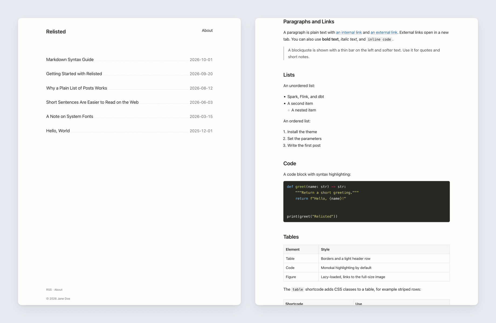

# Relisted

A minimalistic Hugo blogging theme: a plain list of posts, and pages that put the text first. Relisted is a reworked version of [Listed](https://github.com/ronv/listed).



### What's Different from Listed

- **Works with current Hugo.** Listed no longer builds on current Hugo. Relisted needs Hugo 0.160.0 or newer, any edition, and uses no deprecated features.
- **Ready for any site.** Listed hard-codes its site name, menu links, and its author's details in the feeds. Relisted takes all of them from your site config.
- **Better for reading.** New typography and colors, a phone layout with a menu button, and post pages that show the date, tags, and categories.
- **More for writing.** A table of contents, styled tables and figures, images that link to their full size, and newer/older pages for long post lists.

### Features

- A plain list of posts, with newer/older pages
- Header and footer menus from your site config
- Responsive layout, no JavaScript (except optional Google Analytics)
- Table of contents, heading anchors, and syntax highlighting
- Lazy-loaded images that link to the full-size file
- Tags and categories, with a page for each
- Full-text RSS feed
- Open Graph, Twitter cards, and Schema.org data
- Colors, fonts, and width set in your site config

### Installation

Needs Hugo 0.160.0 or newer.

```sh
git submodule add https://github.com/gyli/hugo-theme-relisted.git themes/relisted
```

Add `theme = "relisted"` and `mainSections = ["posts"]` (the sections to list) to your site config. [`exampleSite/hugo.toml`](https://github.com/gyli/hugo-theme-relisted/blob/master/exampleSite/hugo.toml) shows the available settings.

To change colors, fonts, or width, set CSS variables under `[params.style]`. The defaults are in the theme's [`hugo.toml`](https://github.com/gyli/hugo-theme-relisted/blob/master/hugo.toml).

```toml
[params.style]
  color-accent = "#b5442c"
  content-width = "72ch"
```

### License

MIT. Listed is copyright © 2021 Ronalds Vilciņš, and was under the [MIT license](https://github.com/ronv/listed/blob/bc251c5683fdd40ebc3383233b60c9fee17cc3f9/LICENSE.md) when Relisted was forked from it. Relisted changes are copyright © 2022-2026 Guangyang Li.
