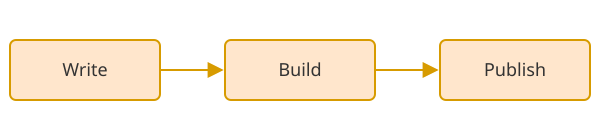



This post shows the Markdown elements that Relisted styles. Use it to check how your own posts will look.

## Headings

Use `##` for main sections and `###` for parts inside them. The post title is the only `h1` on the page.

### A Third-Level Heading

Hover over a heading to see its anchor link.

## Paragraphs and Links

A paragraph is plain text with [an internal link](/about/) and [an external link](https://gohugo.io/). External links open in a new tab. You can also use **bold text**, *italic text*, and `inline code`.

> A blockquote is shown with a thin bar on the left and softer text. Use it for quotes and short notes.

## Lists

An unordered list:

- Spark, Flink, and dbt
- A second item
  - A nested item

An ordered list:

1. Install the theme
2. Set the parameters
3. Write the first post

## Code

A code block with syntax highlighting:

```python
def greet(name: str) -> str:
    """Return a short greeting."""
    return f"Hello, {name}!"


print(greet("Relisted"))
```

## Tables

| Element | Style |
| ------- | ----- |
| Table   | Borders and a light header row |
| Code    | Monokai highlighting by default |
| Figure  | Lazy-loaded, links to the full-size image |

The `table` shortcode adds CSS classes to a table, for example striped rows:


| Shortcode | Use |
| --------- | --- |
| `table_of_contents` | Insert the table of contents |
| `figure` | Insert an image with a caption |
| `table` | Add classes to a table |
| `tagcloud` | List the tags on the site |


## Figures

A Markdown image:




